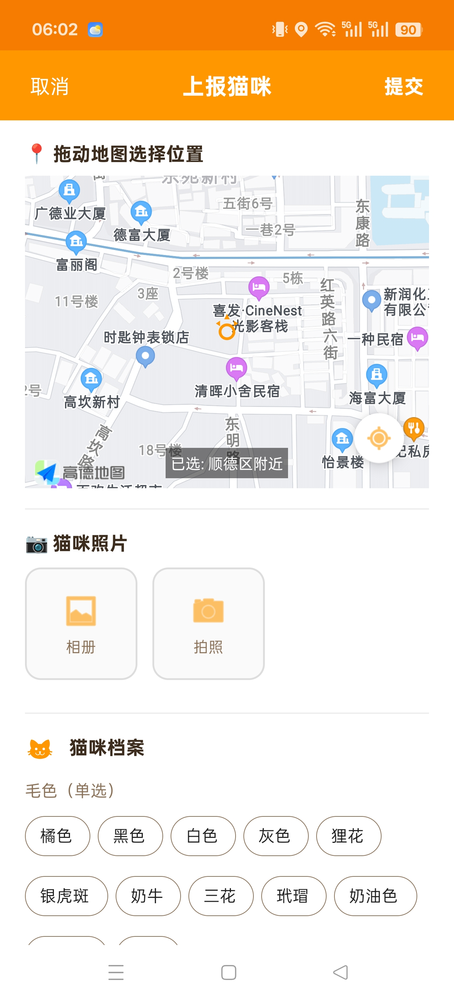
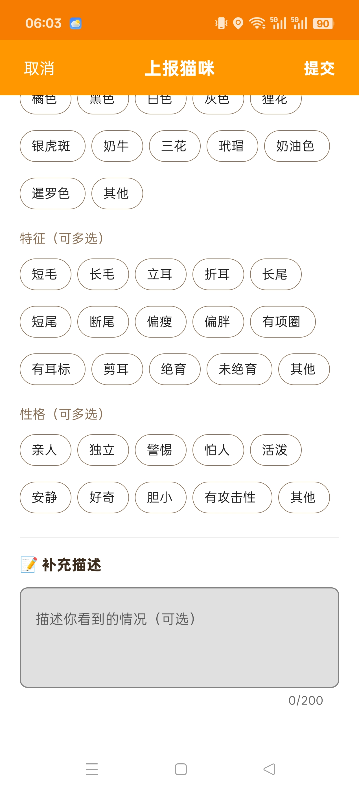
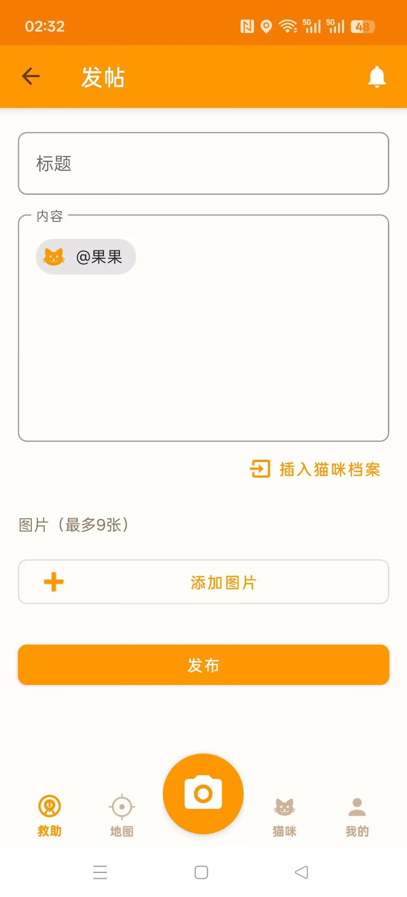
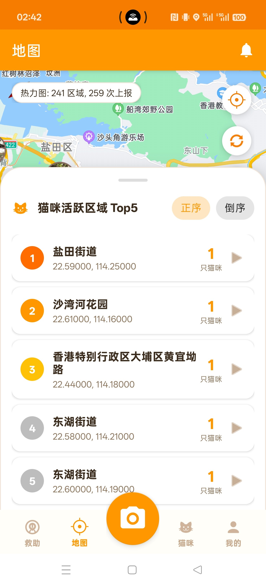

<p align="center">
  
</p>

<p align="center">
  <a href="https://github.com/BlackCoder0/OurCat_Android/blob/main/LICENSE"></a>
  <a href="#"></a>
  <a href="#"></a>
  <a href="#"></a>
  <a href="#"></a>
</p>

# 🐱 OurCat Android

> **让每一只校园猫咪都被看见。**  
> Spring Boot + Android + MySQL 全栈项目中的 Android 原生客户端。拍照上报、AI 识猫、地图找猫、救助协作——把整座校园的猫咪装进口袋。
>
> ⚠️ **运行前需要一个可访问的 [OurCat Backend](https://github.com/BlackCoder0/OurCat_backend) 实例。** 建议先按下方 Quick Start 同时启动后端。

---

## ⚡ Quick Start

1. 用 Android Studio 打开本仓库，等待 Gradle 同步完成
2. 配置 `local.properties`（高德 Key + 后端地址）
3. 启动后端（见上方链接）
4. 在模拟器或真机上 ▶ Run

> 📖 详见下方[快速上手](#-快速上手)。

---

## 📖 项目简介

**OurCat（校园猫谱）** 是一个 **Spring Boot + Android + MySQL** 的全栈校园流浪猫救助平台。本仓库是其中的 Android 客户端。

打开 App，你会看到一个完整运转的猫咪救助世界：

- 📸 **拍照就能上报**——对着猫咪拍一张，AI 自动判断它是不是已经在册的"老熟人"，还是该建档的"新朋友"
- 🗺️ **地图上找猫**——高德地图直观展示猫咪分布，点击标记看档案，热力图看哪里猫最多
- 🚑 **救助一条龙**——发现受伤猫咪 → 发起救助 → 组织成员认领任务 → 更新进度 → 救助完成归档，全程在 App 内闭环
- 💬 **社区互动**——论坛分享养猫心得、广场发布领养信息、消息中心接收天气预警

> 👉 这是 **Android 客户端**。后端 API 服务请见 [OurCat Backend](https://github.com/BlackCoder0/OurCat_backend)

---

## 🎨 功能全景

```
┌──────────────────────────────────────────────────────────┐
│                    🐱 OurCat Android                      │
├──────────────────────────────────────────────────────────┤
│                                                          │
│   📸 猫咪上报          🗺️ 地图探索         🚑 救助中心    │
│   ┌──────────┐       ┌──────────┐       ┌──────────┐   │
│   │拍照→描述  │       │标记点浏览 │       │活动列表  │   │
│   │AI特征提取 │       │猫咪详情  │       │任务认领  │   │
│   │相似匹配   │       │热力图    │       │进度更新  │   │
│   │自动归档   │       │区域推荐  │       │救助日志  │   │
│   └──────────┘       └──────────┘       └──────────┘   │
│                                                          │
│   💬 论坛              📢 广场             👤 我的        │
│   ┌──────────┐       ┌──────────┐       ┌──────────┐   │
│   │多级评论  │       │广播发布  │       │个人动态  │   │
│   │点赞投票  │       │活动推广  │       │我的猫咪  │   │
│   │发帖编辑  │       │评论互动  │       │我的任务  │   │
│   └──────────┘       └──────────┘       │消息通知  │   │
│                                          └──────────┘   │
│                                                          │
│   🌤️ 天气预警 ──── 极端天气自动推送 ──── 🏛️ 组织管理     │
│                                                          │
└──────────────────────────────────────────────────────────┘
```

### 🔥 三大热点功能详解

| 热点 | 操作流程 | 背后发生了什么 |
| :--- | :--- | :--- |
| 📸 **AI 拍照识猫** | 打开相机拍猫 → 选毛色/性别等标签 → 提交 | 图片上传 OSS → 后端 DINOv2 模型提取 768 维特征 → 与全库猫咪余弦比对 → 返回 Top-5 相似猫咪（带相似度）→ 高于 70% 提示"可能已存在"，低于则新建档案 |
| 🚑 **救助一条龙** | 发现受伤猫 → 发起救助活动 → 成员认领任务 → 逐步更新进度 → 完成 | 救助活动发起后自动通知组织成员 → 任务状态流转（待认领→进行中→已完成）→ 每一步可附带文字+图片日志 → 完成后自动更新猫咪健康状态 → **联动天气系统**，极端天气前推送提醒 |
| 🗺️ **地图 × 热力图** | 打开地图页 → 缩放浏览 → 点击标记看猫咪 → 切换热力图看密度 | 高德 SDK 渲染猫咪坐标点 → 点击弹出卡片（照片+品种+最后目击时间）→ 热力图模式展示猫咪活动热点区域 → **推荐区域**：AI 分析哪些区域猫最多但尚未有救助覆盖 |

---

## 📸 界面预览

> 按用户操作流程编排：发现猫 → 上报识别 → 地图找猫 → 发起救助 → 社区互动 → 个人中心。

### 🐈 发现猫 → 拍照上报 → AI 识别

| 上报表单 | 猫咪档案详情 |
| :---: | :---: |
|  |  |

### 🗺️ 地图找猫 → 查看档案 → 热力图分析

| 猫咪点位地图 | 救助联动界面 | 热力图 |
| :---: | :---: | :---: |
|  |  |  |

### 💬 社区互动：论坛发帖 + 广场广播

| 论坛帖子列表 | 广场广播 | 发布界面 |
| :---: | :---: | :---: |
|  |  |  |

| 论坛发帖编辑 | 
| :---: | 
|  |

### 🚑 救助一条龙：发起 → 认领 → 执行 → 归档

| 活动详情 | 进度追踪 | 推荐区域 |
| :---: | :---: | :---: |
|  |  |  |

---

## 🏗️ 客户端架构

```
┌─────────────────────────────────────────────────┐
│               OurCat Android App                  │
├─────────────────────────────────────────────────┤
│                                                   │
│  🎨 UI Layer（Fragment + ViewPager2 导航）         │
│  ┌─────────────────────────────────────────┐    │
│  │ MapFragment          高德 3D 地图交互    │    │
│  │ CatsListFragment     猫咪列表/搜索/筛选  │    │
│  │ CatProfileFragment   猫咪详情/AI匹配结果 │    │
│  │ RescueHomeFragment   救助活动首页        │    │
│  │ RescueDetailFragment 任务管理/进度更新   │    │
│  │ ForumFragment        帖子列表/发帖       │    │
│  │ PostDetailFragment   评论/点赞           │    │
│  │ SquareFragment       广场广播            │    │
│  │ MessageCenterFragment 通知/天气预警      │    │
│  │ ProfileFragment      个人中心/我的动态   │    │
│  └─────────────────────────────────────────┘    │
│                                                   │
│  🔌 Network Layer                                │
│  ┌─────────────────────────────────────────┐    │
│  │ RetrofitHelper    Retrofit 2.9 + OkHttp  │    │
│  │ TokenStore        JWT 持久化存储          │    │
│  │ OssUploader       预签名直传 OSS          │    │
│  └─────────────────────────────────────────┘    │
│                                                   │
│  📱 App Core                                     │
│  ┌─────────────────────────────────────────┐    │
│  │ OurCatApp         高德 SDK 初始化         │    │
│  │ MainActivity      底部四栏 Tab 导航       │    │
│  └─────────────────────────────────────────┘    │
│                                                   │
└──────────────────────┬────────────────────────────┘
                       │
           JWT + REST API（debug 走 HTTP，生产建议 HTTPS）
                       │
                       ▼
          ┌─────────────────────────┐
          │   OurCat Backend 服务    │
          │   Spring Boot + MySQL   │
          └─────────────────────────┘
```

---

## 📁 目录结构

```text
android/
├── app/
│   ├── build.gradle                 # 依赖：Retrofit, Glide, 高德SDK, MPAndroidChart
│   └── src/main/
│       ├── AndroidManifest.xml      # 权限 + 高德Key占位（local.properties注入）
│       │
│       ├── java/com/ourcat/app/
│       │   ├── OurCatApp.java       # 🚀 Application（初始化高德SDK）
│       │   ├── activities/          # Activity 层
│       │   │   ├── MainActivity     # 主界面（底部Tab + Fragment容器）
│       │   │   └── LoginActivity    # 登录/注册
│       │   ├── fragments/           # 🎨 业务 Fragment（含 DialogFragment）
│       │   │   ├── MapFragment      # 🗺️ 地图：猫咪标记、热力图、定位
│       │   │   ├── CatsListFragment # 🐈 猫咪列表 + 搜索过滤
│       │   │   ├── CatProfileFragment # 📋 猫咪档案详情
│       │   │   ├── ReportCatDialogFragment # 📸 猫咪上报弹窗
│       │   │   ├── RescueHomeFragment # 🚑 救助活动首页
│       │   │   ├── RescueDetailFragment # 📊 救助详情 + 任务分配
│       │   │   ├── RescueGuideFragment # 📖 救助指南
│       │   │   ├── RescueKnowledgeFragment # 📚 救助知识库
│       │   │   ├── ForumFragment    # 💬 论坛帖子列表
│       │   │   ├── PostDetailFragment # 💬 帖子详情/评论/点赞
│       │   │   ├── CreateEditPostFragment # ✏️ 发帖/编辑
│       │   │   ├── SquareFragment   # 📢 广场
│       │   │   ├── CreateSquarePostFragment # 📝 发布广播
│       │   │   ├── MessageCenterFragment # ✉️ 消息/通知/预警
│       │   │   ├── ProfileFragment  # 👤 个人中心
│       │   │   ├── OrgFragment      # 🏛️ 组织管理
│       │   │   ├── JoinRequestsFragment # ✅ 入群审批
│       │   │   └── AssignMemberDialogFragment # 👥 任务分配弹窗
│       │   ├── adapters/            # 🔗 8 个 RecyclerView 适配器
│       │   └── utils/               # 🔧 RetrofitHelper, TokenStore, OssUploader
│       │
│       └── res/                     # 🎨 布局、图标、颜色、字符串
│
├── build.gradle                     # 项目级 Gradle（Android SDK 34）
├── local.properties                 # 🔒 本地密钥（已 .gitignore，不提交）
└── .gitignore
```

---

## 🚀 快速上手

从零到 App 跑起来，只需四步。

---

### 第一步：安装 Android Studio

如果已有 Android Studio Hedgehog (2023.1.1) 或更新版本，跳过此步。

1. 下载 [Android Studio](https://developer.android.com/studio) 并安装
2. 首次启动时，SDK Manager 会自动提示安装 **Android SDK 34**——勾选并下载
3. 如果已安装但缺少 SDK 34：`File → Settings → Languages & Frameworks → Android SDK`，勾选 `Android 14.0 (API 34)`，Apply

---

### 第二步：克隆仓库

```bash
git clone https://github.com/BlackCoder0/OurCat_Android.git
```

用 Android Studio 打开项目目录（`File → Open → 选择 OurCat_Android 文件夹`），等待底部进度条 Gradle 同步完成。

> 📌 首次同步会下载依赖（Retrofit、Glide、高德 SDK 等），视网速可能需要 3-10 分钟。

---

### 第三步：配置 `local.properties`

项目中的 `local.properties` 已在 `.gitignore` 中排除，**不会提交到仓库**。打开它：

```properties
# 高德地图 API Key —— 在 https://console.amap.com 申请（免费）
OURCAT_AMAP_KEY_DEBUG=你的调试Key
OURCAT_AMAP_KEY_RELEASE=你的发布Key

# 后端 API 地址
OURCAT_BASE_URL_DEBUG=http://10.0.2.2:8080/
OURCAT_BASE_URL_RELEASE=https://你的服务器地址/

# Android SDK 路径（Android Studio 自动生成的，不要改）
sdk.dir=C\:\\Users\\你的用户名\\AppData\\Local\\Android\\Sdk
```

| 配置项 | 优先级 | 怎么填 |
| :--- | :--- | :--- |
| `OURCAT_AMAP_KEY_DEBUG` | **必填** | 去 [高德开放平台](https://console.amap.com) → 创建应用 → 添加 Key → 服务平台选"Android" → 填写 SHA1（调试用 `androiddebugkey` 的 SHA1）→ 获取 Key |
| `OURCAT_BASE_URL_DEBUG` | **必填** | 模拟器填 `http://10.0.2.2:8080/`，真机填 `http://你的局域网IP:8080/`（见下方网络决策表） |
| `OURCAT_AMAP_KEY_RELEASE` | 发布时需要 | 同上填发布版 SHA1，暂时不发布可留空 |
| `OURCAT_BASE_URL_RELEASE` | 发布时需要 | 正式服务器地址，未部署可留空 |

> ⚠️ **如何获取调试 SHA1？** 打开终端执行：
> ```bash
> keytool -list -v -keystore ~/.android/debug.keystore -alias androiddebugkey -storepass android
> ```
> 复制输出的 `SHA1: ` 后面的值，填入高德控制台。

---

### 第四步：启动后端并运行 App

**App 必须有后端才能工作**——你需要先让后端跑起来：

```bash
# 克隆后端（如果还没有）
git clone https://github.com/BlackCoder0/OurCat_backend.git
cd OurCat_backend

# 开发模式启动（H2 内存数据库，零配置）
mvn spring-boot:run -Dspring-boot.run.profiles=dev
```

后端启动后，回到 Android Studio：

1. 顶部工具栏选择 `app` 模块
2. 点击绿色 **▶ Run** 按钮（或 Shift+F10）
3. 选择模拟器（推荐 Pixel 系列，API 34）或 USB 连接的手机
4. 等待 APK 编译安装 → App 自动启动

#### 网络连接说明

| 场景 | `OURCAT_BASE_URL_DEBUG` 应填什么 | 原理 |
| :--- | :--- | :--- |
| **Android 模拟器** | `http://10.0.2.2:8080/` | 模拟器内置 NAT，`10.0.2.2` 固定指向宿主机 `localhost` |
| **同 WiFi 真机** | `http://你的局域网IP:8080/` | 手机和电脑连同一 WiFi；用 `ipconfig` 查电脑 IP |
| **线上环境** | `https://你的域名/` | 填入 `OURCAT_BASE_URL_RELEASE` |

<details>
<summary>📡 网络拓扑示意（点击展开）</summary>

```
🖥️ 模拟器模式（最简单）
┌──────────┐   10.0.2.2:8080    ┌──────────┐
│ Android  │ ──────────────────▶│ 宿主机    │
│ 模拟器    │    (NAT 固定地址)   │ localhost │
└──────────┘                    │ :8080    │
                                └──────────┘

📱 真机 USB 调试
┌──────────┐  192.168.x.x:8080  ┌──────────┐
│ Android  │ ──────────────────▶│ 电脑      │
│ 真机      │   (同一 WiFi 下)    │ :8080    │
└──────────┘                    └──────────┘

🌐 正式发布
┌──────────┐  https://你的域名   ┌──────────┐
│ Android  │ ──────────────────▶│ 服务器    │
│ 用户手机  │                    │ :8080    │
└──────────┘                    └──────────┘
```

</details>

#### 常见问题排查

| 现象 | 可能原因 | 解决办法 |
| :--- | :--- | :--- |
| Gradle 同步失败 | 网络不通或 SDK 版本缺失 | 检查代理，确认已安装 Android SDK 34 |
| App 闪退 | 高德 Key 未配置或 SHA1 不匹配 | 检查 `local.properties` 中的 Key，重新获取调试 SHA1 |
| 接口请求失败 | 后端未启动或地址不对 | 模拟器用 `10.0.2.2`，真机用局域网 IP；curl 测试后端是否可达 |
| 地图不显示 | 高德 Key 错误 | 查看 Logcat 搜 `amap`，通常有明确错误提示 |

---

## 🛠️ 技术栈

| 层面 | 选型 |
| :--- | :--- |
| 语言 | Java 11 |
| 最低兼容 | Android 7.0 (API 24) |
| 目标版本 | Android 14 (API 34) |
| HTTP | Retrofit 2.9 + OkHttp 4.12 |
| 地图 | 高德 3D 地图 SDK 9.6 + 搜索 SDK 9.7 |
| 图片 | Glide 4.16 |
| 图表 | MPAndroidChart v3.1.0 |
| JSON | Gson 2.10 |
| 架构 | Fragment + ViewPager2 + Navigation |

---

## 🔒 安全设计

* **零硬编码凭据**：高德 Key 和后端地址通过 `local.properties` 注入，源码中无任何真实密钥。
* **JWT 安全存储**：Token 存于 Android SharedPreferences（应用私有目录），外部不可读。
* **OSS 预签名上传**：上传流程为 `GET /api/oss/upload-url` → 获取临时预签名 URL → 直传，客户端不持有 OSS AccessKey。
* **网络安全**：生产部署时建议启用 HTTPS 并配置 Network Security Config。

---

## 🤝 贡献与鸣谢

如果你觉得这个项目对校园流浪猫救助有意义，欢迎点一个 **⭐ Star**！

---

## 📌 当前状态

- **运行前提**：需要一个可访问的 [OurCat Backend](https://github.com/BlackCoder0/OurCat_backend) 实例
- **最低兼容**：Android 7.0 (API 24)，已在 API 34 模拟器上验证
- **地图功能**：依赖高德 3D 地图 SDK，需在[高德开放平台](https://console.amap.com)申请 Key
- **当前覆盖**：猫咪上报、AI 识猫、地图探索、救助协作、论坛、广场、消息通知
- **Last reviewed**：2026-06-08

---

## 📄 开源协议

MIT License

---

## 🌐 English

**OurCat Android** is the native Android client for the OurCat campus stray cat rescue platform. Built with Java 11 and targeting Android 7.0+, it features AI-powered cat photo recognition, Amap-based location tracking with heatmap visualization, a full rescue task scheduling workflow, forum & community square, and extreme weather alert notifications — all backed by a Spring Boot + MySQL API server.

> 👉 **Android repo** (this one) · [Backend](https://github.com/BlackCoder0/OurCat_backend)

---

OurCat — 让每一只校园猫都被看见 ❤️
  <sub>OurCat — 让每一只校园猫咪都被看见 ❤️</sub>
</p>
