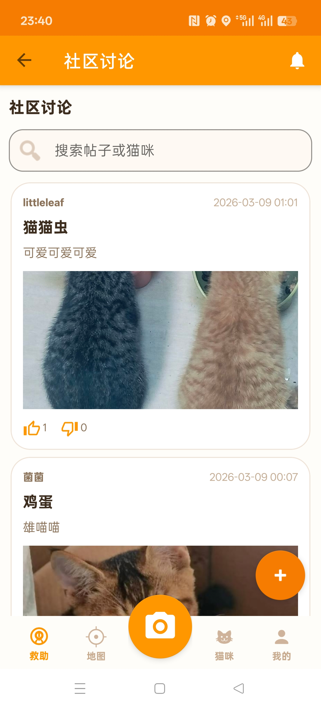

<p align="center"></p>

# OurCat Android

这是我的毕业设计 OurCat（校园猫谱）的 Android 客户端。可以上报猫咪、查看档案、参与救助和发布社区内容，需要连接 [OurCat Backend](https://github.com/BlackCoder0/OurCat_backend)。开源版本使用运行者自己的实例，不连接作者的公共服务。

## 看看项目

| 猫咪上报 | 地图与救助 | 社区讨论 |
| --- | --- | --- |
|  |  |  |

[完整截图](docs/screenshots.md)来自配置过地图和云服务的版本。Demo APK 不内置地图 Key，AI 默认关闭；实际体验范围见下表。

## 怎样体验

使用包含本地后端与 Demo APK 的 [Windows 预发布包](https://github.com/BlackCoder0/OurCat_backend/releases)，按 [后端本地体验教程](https://github.com/BlackCoder0/OurCat_backend/blob/main/docs/local-experience.md)运行。电脑需要保持开机，手机与电脑需要网络互通。下载以 Releases 中实际存在的附件为准。

Demo 包名为 `com.ourcat.app.demo`，应用名为“OurCat 本地体验”，能与原 App 共存。在登录页点“设置后端地址”：

- Android 模拟器：`http://10.0.2.2:8080/`
- 手机：`http://电脑局域网IP:8080/`，不能填写手机自己的 `localhost`

切换实例前先退出登录。保存新地址会取消旧 API 请求、清除 Token 和最近浏览记录，再获取新验证码。各实例账号独立。

| 功能 | 本地 Demo |
| --- | --- |
| 账号、猫咪档案、论坛、广场 | 使用本地数据，支持注册、发帖和互动 |
| 头像与帖子图片 | 保存在本地 Backend 的图片目录 |
| 组织、任务 | 管理员审核、分配；成员申领和提交文字日志 |
| 上报位置 | 使用明确标注的上海示例坐标，方便研究流程 |
| 真实地图、定位、图片 AI | Demo 默认不提供；从源码配置自己的 Key 与服务 |

实体手机、陌生电脑安装仍需验收，当前不能把此包当作已经运营的公共社区 App。

## 从源码构建

需要 JDK 17、Android SDK 34 和 Gradle Wrapper（仓库已包含）。Android Studio 打开项目后确认 `local.properties` 的 SDK 路径：

```properties
sdk.dir=C:/Users/你的用户名/AppData/Local/Android/Sdk
```

启动自己的 Backend，然后在仓库根目录构建：

```powershell
.\gradlew.bat assembleDemo
```

输出为 `app/build/outputs/apk/demo/app-demo.apk`。macOS/Linux 使用 `./gradlew assembleDemo`。普通 Debug/Release 继续读取你自己的编译期配置，见 [开发指南](docs/development.md)。Demo 的初始地址固定为本地默认值，不继承私人云端地址或地图 Key。

## 继续读源码

从 `ReportCatDialogFragment → CatApi → Backend CatController` 跟踪一次上报；从 `LoginFragment → RetrofitHelper → TokenStore` 阅读登录与实例切换。界面使用 Java、Fragment、Navigation、Retrofit/OkHttp 和 Glide。最低 Android 7.0（API 24），目标 SDK 34；Release 保持禁止明文 HTTP。

[开发与配置](docs/development.md) · [功能截图](docs/screenshots.md) · [验证记录](docs/validation.md) · [后端架构和 API](https://github.com/BlackCoder0/OurCat_backend)

## 反馈与许可

欢迎提交 [Issue](https://github.com/BlackCoder0/OurCat_Android/issues)，附 Android 版本、构建类型、后端版本和复现步骤，日志中请遮掉 Token 和个人信息。OurCat 代码使用 [MIT](LICENSE)，第三方 SDK 仍遵循自身许可。
