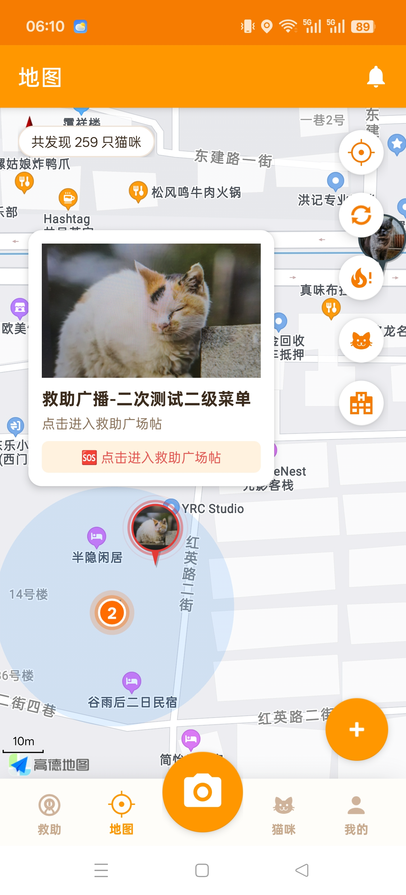
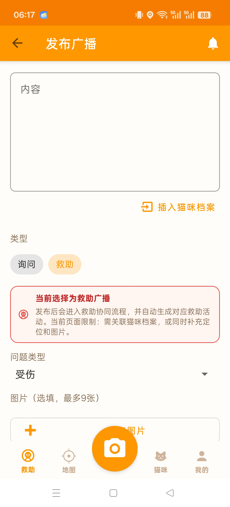
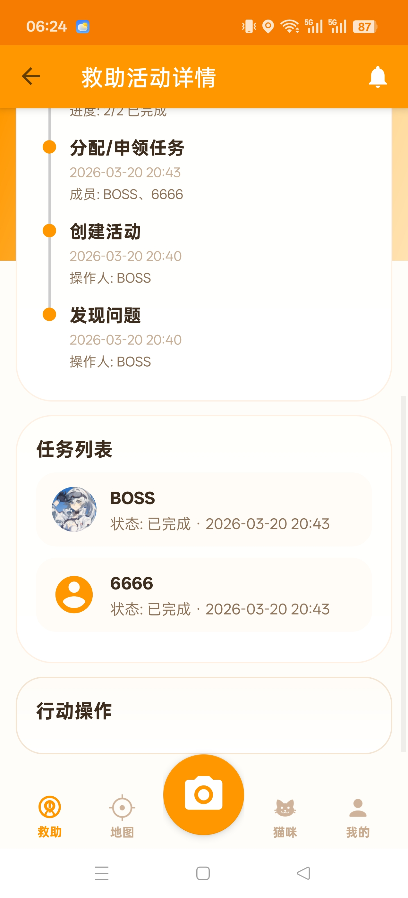

<p align="center">
  
</p>

<p align="center">
  <a href="https://github.com/BlackCoder0/OurCat_Android/blob/main/LICENSE"></a>
  <a href="#"></a>
  <a href="#"></a>
  <a href="#"></a>
  <a href="#"></a>
</p>

# 🐱 OurCat Android

> **让每一只校园猫都被看见。**
>
> Spring Boot + Android + MySQL 全栈项目中的 Android 原生客户端。拍照上报、AI 识猫、地图找猫、救助协作——把整座校园的猫咪装进口袋。
>
> ⚠️ **运行前需要一个可访问的 [OurCat Backend](https://github.com/BlackCoder0/OurCat_backend) 实例。** 本项目默认按本地 Backend 说明运行；公开仓库不提供现成的云端 Backend 地址。

---

## ⚡ Quick Start

> 本仓库当前未提交 `gradlew`、`gradlew.bat` 和 `gradle-wrapper.jar`。以下流程以 Android Studio 的同步和运行功能为准；不要直接执行 `./gradlew` 或 `gradlew.bat`，命令行构建需要先补齐 Gradle Wrapper。

1. 安装 Android Studio 和 Android SDK 34。
2. 用 Android Studio 打开本仓库，等待 Gradle 同步完成。
3. 在项目根目录创建或编辑 `local.properties`。
4. 配置 Debug Backend 地址；模拟器使用 `http://10.0.2.2:8080/`。
5. 启动 [OurCat Backend](https://github.com/BlackCoder0/OurCat_backend)。
6. 在 Android Studio 中运行 `app`。

> 📖 这条路径只需要先跑通 Backend 和 Android 基础页面。高德地图、OSS 图片上传和 Replicate AI 需要按功能额外配置。

---

## 📖 项目简介

**OurCat（校园猫谱）** 是一个 **Spring Boot + Android + MySQL** 的全栈校园流浪猫救助平台。本仓库是其中的 Android 客户端。

打开 App，你会看到一个完整运转的猫咪救助世界：

- 📸 **拍照就能上报**——对着猫咪拍一张，提交后由 Backend 异步判断它是不是已经在册的"老熟人"，还是该建档的"新朋友"
- 🗺️ **地图上找猫**——高德地图直观展示猫咪分布，点击标记看档案，热力图看哪里猫最多
- 🚑 **救助一条龙**——发现受伤猫咪 → 发起救助 → 组织成员认领任务 → 更新进度 → 救助完成归档，全程在 App 内闭环
- 💬 **社区互动**——论坛分享养猫心得、广场发布领养信息、消息中心接收天气预警

> 👉 这是 **Android 客户端**。后端 API 服务请见 [OurCat Backend](https://github.com/BlackCoder0/OurCat_backend)

---

## ⭐ 先看核心体验

- **拍照上报**：记录猫咪照片、位置和特征，提交到 Backend。
- **地图探索**：查看猫咪位置、热力图和推荐区域。
- **救助协作**：发起活动、认领任务、更新进度并留下日志。
- **社区沟通**：使用论坛、广场和消息中心协作。

### 三张代表性截图

| 拍照上报 | 地图探索 | 救助协作 |
| :---: | :---: | :---: |
|  |  |  |

> 这些页面需要可访问的 Backend；AI 识猫还需要 Replicate，地图和定位还需要高德 Android Key，图片上传还需要 Backend 配置阿里云 OSS。

---

## 🎨 功能全景

```
┌──────────────────────────────────────────────────────────┐
│                    🐱 OurCat Android                      │
├──────────────────────────────────────────────────────────┤
│                                                          │
│   📸 猫咪上报          🗺️ 地图探索         🚑 救助中心    │
│   ┌──────────┐       ┌──────────┐       ┌──────────┐   │
│   │拍照→描述  │       │标记点浏览 │       │活动列表  │   │
│   │AI特征提取 │       │猫咪详情  │       │任务认领  │   │
│   │相似匹配   │       │热力图    │       │进度更新  │   │
│   │自动归档   │       │区域推荐  │       │救助日志  │   │
│   └──────────┘       └──────────┘       └──────────┘   │
│                                                          │
│   💬 论坛              📢 广场             👤 我的        │
│   ┌──────────┐       ┌──────────┐       ┌──────────┐   │
│   │评论互动  │       │广播发布  │       │个人动态  │   │
│   │点赞投票  │       │活动推广  │       │我的猫咪  │   │
│   │发帖编辑  │       │评论互动  │       │我的任务  │   │
│   └──────────┘       └──────────┘       │消息通知  │   │
│                                          └──────────┘   │
│                                                          │
│   🌤️ 天气预警 ──── 天气查询与提醒 ──── 🏛️ 组织管理       │
│                                                          │
└──────────────────────────────────────────────────────────┘
```

### 🔥 三大热点功能详解

| 热点 | 操作流程 | 背后发生了什么 |
| :--- | :--- | :--- |
| 📸 **AI 拍照识猫** | 打开相机拍猫 → 选毛色/性别等标签 → 提交 | 图片上传 OSS → Backend 调用 Replicate 提取图片特征 → 与已有猫咪档案进行相似度比对 → 返回候选结果 → 达到阈值时提示可能已存在，否则创建新档案 |
| 🚑 **救助一条龙** | 发现受伤猫 → 发起救助活动 → 成员认领任务 → 逐步更新进度 → 完成 | 创建活动后由创建者或组织管理员指派任务，组织成员也可主动申领；指派/申领时写入消息 → 任务状态流转（待认领→进行中→已完成）→ 每一步可附带文字+图片日志 → 完成后自动更新猫咪健康状态；天气预警由独立天气查询产生并写入消息 |
| 🗺️ **地图 × 热力图** | 打开地图页 → 缩放浏览 → 点击标记看猫咪 → 切换热力图看密度 | 高德 SDK 渲染猫咪坐标点 → 点击弹出卡片（照片+品种+最后目击时间）→ 热力图模式展示猫咪活动热点区域 → **推荐区域**：按最近上报数量排序，显示高活跃或低活跃网格 |

---

## 📸 完整界面预览

> 按用户操作流程编排：发现猫 → 上报识别 → 地图找猫 → 发起救助 → 社区互动 → 个人中心。

### 🐈 发现猫 → 拍照上报 → AI 识别

| 上报表单 | 猫咪档案详情 |
| :---: | :---: |
|  |  |

### 🗺️ 地图找猫 → 查看档案 → 热力图分析

| 猫咪点位地图 | 救助联动界面 | 热力图 |
| :---: | :---: | :---: |
|  |  |  |

### 💬 社区互动：论坛发帖 + 广场广播

| 论坛帖子列表 | 广场广播 | 发布界面 |
| :---: | :---: | :---: |
|  |  |  |

| 论坛发帖编辑 | 
| :---: | 
|  |

### 🚑 救助一条龙：发起 → 认领 → 执行 → 归档

| 活动详情 | 进度追踪 | 推荐区域 |
| :---: | :---: | :---: |
|  |  |  |

---

## 🏗️ 客户端架构

```
┌─────────────────────────────────────────────────┐
│               OurCat Android App                  │
├─────────────────────────────────────────────────┤
│                                                   │
│  🎨 UI Layer（Fragment + ViewPager2 导航）         │
│  ┌─────────────────────────────────────────┐    │
│  │ MapFragment          高德 3D 地图交互    │    │
│  │ CatsListFragment     猫咪列表/搜索/筛选  │    │
│  │ CatProfileFragment   猫咪详情/AI匹配结果 │    │
│  │ RescueHomeFragment   救助活动首页        │    │
│  │ RescueDetailFragment 任务管理/进度更新   │    │
│  │ ForumFragment        帖子列表/发帖       │    │
│  │ PostDetailFragment   评论/点赞           │    │
│  │ SquareFragment       广场广播            │    │
│  │ MessageCenterFragment 通知/天气预警      │    │
│  │ ProfileFragment      个人中心/我的动态   │    │
│  └─────────────────────────────────────────┘    │
│                                                   │
│  🔌 Network Layer                                │
│  ┌─────────────────────────────────────────┐    │
│  │ RetrofitHelper    Retrofit 2.9 + OkHttp  │    │
│  │ TokenStore        JWT 持久化存储          │    │
│  │ OssUploader       预签名直传 OSS          │    │
│  └─────────────────────────────────────────┘    │
│                                                   │
│  📱 App Core                                     │
│  ┌─────────────────────────────────────────┐    │
│  │ OurCatApp         高德 SDK 初始化         │    │
│  │ MainActivity      底部四栏 Tab 导航       │    │
│  └─────────────────────────────────────────┘    │
│                                                   │
└──────────────────────┬────────────────────────────┘
                       │
           JWT + REST API（Debug 允许本地 HTTP，Release 仅允许 HTTPS）
                       │
                       ▼
          ┌─────────────────────────┐
          │   OurCat Backend 服务    │
          │   Spring Boot + MySQL   │
          └─────────────────────────┘
```

---

## 📁 目录结构

```text
android/
├── app/
│   ├── build.gradle                 # 依赖：Retrofit, Glide, 高德SDK, MPAndroidChart
│   └── src/main/
│       ├── AndroidManifest.xml      # 权限 + 高德Key占位（local.properties注入）
│       │
│       ├── java/com/ourcat/app/
│       │   ├── OurCatApp.java       # 🚀 Application（初始化高德SDK）
│       │   ├── activities/          # Activity 层
│       │   │   ├── MainActivity     # 主界面（底部Tab + Fragment容器）
│       │   │   └── LoginActivity    # 登录/注册
│       │   ├── fragments/           # 🎨 业务 Fragment（含 DialogFragment）
│       │   │   ├── MapFragment      # 🗺️ 地图：猫咪标记、热力图、定位
│       │   │   ├── CatsListFragment # 🐈 猫咪列表 + 搜索过滤
│       │   │   ├── CatProfileFragment # 📋 猫咪档案详情
│       │   │   ├── ReportCatDialogFragment # 📸 猫咪上报弹窗
│       │   │   ├── RescueHomeFragment # 🚑 救助活动首页
│       │   │   ├── RescueDetailFragment # 📊 救助详情 + 任务分配
│       │   │   ├── RescueGuideFragment # 📖 救助指南
│       │   │   ├── RescueKnowledgeFragment # 📚 救助知识库
│       │   │   ├── ForumFragment    # 💬 论坛帖子列表
│       │   │   ├── PostDetailFragment # 💬 帖子详情/评论/点赞
│       │   │   ├── CreateEditPostFragment # ✏️ 发帖/编辑
│       │   │   ├── SquareFragment   # 📢 广场
│       │   │   ├── CreateSquarePostFragment # 📝 发布广播
│       │   │   ├── MessageCenterFragment # ✉️ 消息/通知/预警
│       │   │   ├── ProfileFragment  # 👤 个人中心
│       │   │   ├── OrgFragment      # 🏛️ 组织管理
│       │   │   ├── JoinRequestsFragment # ✅ 入群审批
│       │   │   └── AssignMemberDialogFragment # 👥 任务分配弹窗
│       │   ├── adapters/            # 🔗 8 个 RecyclerView 适配器
│       │   └── utils/               # 🔧 RetrofitHelper, TokenStore, OssUploader
│       │
│       └── res/                     # 🎨 布局、图标、颜色、字符串
│
├── build.gradle                     # 项目级 Gradle（Android SDK 34）
├── local.properties                 # 🔒 本地配置（可能需要手动创建，不提交）
└── .gitignore
```

---

## 🚀 快速上手

下面按“先启动基础 App，再逐步启用功能”的顺序操作。不要一开始就配置所有 Key。

---

### 第一步：安装 JDK 17 和 Android Studio

本项目使用 AGP 8.2.0，Gradle 运行环境需要 **JDK 17**。源码仍以 Java 11 作为兼容级别，这两个概念不要混为一谈。

1. 安装 JDK 17，并确认 `java -version` 显示 17。
2. 下载并安装 [Android Studio](https://developer.android.com/studio)。
3. 在 Android Studio 中打开 `File → Settings → Build, Execution, Deployment → Build Tools → Gradle`，将 **Gradle JDK** 设置为 JDK 17。
4. 在 SDK Manager 中安装 **Android SDK 34**。

如果已有 Android Studio Hedgehog (2023.1.1) 或更新版本，可跳过安装步骤，但仍要确认 Gradle JDK 为 17、Android SDK 34 已安装。

---

### 第二步：打开项目

```bash
git clone https://github.com/BlackCoder0/OurCat_Android.git
```

用 Android Studio 打开项目目录（`File → Open → 选择 OurCat_Android 文件夹`），等待 Gradle 同步完成。

> 📌 首次同步会下载依赖（Retrofit、Glide、高德 SDK 等），视网速可能需要 3-10 分钟。

---

### 第三步：配置 `local.properties`

`local.properties` 已在 `.gitignore` 中排除，**不会提交到仓库**。新克隆项目后如果文件不存在，请在 Android 项目根目录手动新建它。至少写入下面的内容：

```properties
# Android SDK 路径。Android Studio 通常会自动写入，不要随意修改
sdk.dir=C\:\\Users\\你的用户名\\AppData\\Local\\Android\\Sdk

# Debug：Android 模拟器访问宿主机 Backend
OURCAT_BASE_URL_DEBUG=http://10.0.2.2:8080/

# 地图功能需要；暂时没有 Key 可先留空，但地图和定位不可用
OURCAT_AMAP_KEY_DEBUG=你的调试Key
```

| 配置项 | 优先级 | 怎么填 |
| :--- | :--- | :--- |
| `sdk.dir` | 编译必需 | 填本机 Android SDK 路径；Android Studio 通常会自动生成 |
| `OURCAT_BASE_URL_DEBUG` | 真机或自定义后端时需要 | 模拟器不填也会使用默认值 `http://10.0.2.2:8080/`；真机填电脑局域网 IP；云端填自己的 HTTPS 地址 |
| `OURCAT_AMAP_KEY_DEBUG` | 地图功能必需 | 在 [高德开放平台](https://console.amap.com) 创建 Android Key，并配置应用包名和 Debug SHA1 |
| `OURCAT_BASE_URL_RELEASE` | 正式发布必需 | 填真实可访问的 HTTPS Backend 地址；没有云端地址时不要使用 Release 包联调 |
| `OURCAT_AMAP_KEY_RELEASE` | 正式发布地图必需 | 使用 Release 签名证书对应的 SHA1 申请的高德 Android Key |

配置影响：

- 没有 `OURCAT_BASE_URL_DEBUG`：模拟器会使用默认的 `http://10.0.2.2:8080/`；真机、局域网或云端场景必须填写正确地址，否则 App 无法访问登录和业务接口。
- 没有 `OURCAT_AMAP_KEY_DEBUG`：地图、定位和依赖定位的功能不可用，但 App 不一定无法启动。
- 没有 `OURCAT_BASE_URL_RELEASE`：不能把 Release 包连接到真实 Backend；当前项目不提供公共云端地址。

获取 Debug SHA1：

Windows PowerShell：

```powershell
keytool -list -v `
  -keystore "$env:USERPROFILE\.android\debug.keystore" `
  -alias androiddebugkey `
  -storepass android
```

macOS/Linux：

```bash
keytool -list -v -keystore ~/.android/debug.keystore -alias androiddebugkey -storepass android
```

复制输出的 `SHA1: ` 后面的值，填入高德控制台。

---

### 第四步：启动本地 Backend

**App 必须有后端才能工作**——你需要先让后端跑起来：

```powershell
# 克隆后端（如果还没有）
git clone https://github.com/BlackCoder0/OurCat_backend.git
cd OurCat_backend

# 没有 Replicate 时先关闭 AI
$env:AI_ENABLED = "false"
mvn spring-boot:run "-Dspring-boot.run.profiles=dev"
```

看到 `Started OurCatApplication` 后，另开终端验证：

```powershell
curl.exe http://localhost:8080/api/auth/captcha
```

如果返回包含 `key` 和 `image` 的 JSON，再回到 Android Studio：

1. 顶部工具栏选择 `app` 模块
2. 点击绿色 **▶ Run** 按钮（或 Shift+F10）
3. 选择模拟器（推荐 Pixel 系列，API 34）或 USB 连接的手机
4. 等待 APK 编译安装 → App 自动启动

### 第五步：按需启用功能

| 你想使用的功能 | 还需要什么 |
| :--- | :--- |
| 登录、基础页面、论坛和救助基础流程 | Backend 可访问，Android Debug 地址正确 |
| 地图和定位 | Android 高德 Debug Key |
| 图片、头像、帖子和救助日志上传 | Backend 配置阿里云 OSS |
| AI 识猫 | Backend 配置 Replicate，并打开 AI |
| 天气提醒 | Backend 默认可使用 Open-Meteo；官方灾害预警需要和风天气 JWT |

Android 端不会保存 OSS AccessKey 或 Replicate Token。它们应该配置在 Backend 服务器中。

#### 网络连接说明

| 场景 | `OURCAT_BASE_URL_DEBUG` 应填什么 | 原理 |
| :--- | :--- | :--- |
| **Android 模拟器** | `http://10.0.2.2:8080/` | 模拟器内置 NAT，`10.0.2.2` 固定指向宿主机 `localhost` |
| **同 WiFi 真机** | `http://你的局域网IP:8080/` | 手机和电脑连同一 WiFi；用 `ipconfig` 查电脑 IP |
| **云端 Backend** | `https://你的云端域名/` | 测试时填入 `OURCAT_BASE_URL_DEBUG`；正式发布填入 `OURCAT_BASE_URL_RELEASE` |

切换到云端：

1. 先在自己的云服务器启动 Backend。
2. 确认云端 Backend 可以通过 HTTPS 访问。
3. 修改 `local.properties` 中的 Base URL。
4. 重新运行 App；已经构建好的 APK 不会自动读取后来修改的配置。

公开仓库不提供当前项目的云端地址。没有自己的云端 Backend 时，请使用本地 Backend。

<details>
<summary>📡 网络拓扑示意（点击展开）</summary>

```
🖥️ 模拟器模式（最简单）
┌──────────┐   10.0.2.2:8080    ┌──────────┐
│ Android  │ ──────────────────▶│ 宿主机    │
│ 模拟器    │    (NAT 固定地址)   │ localhost │
└──────────┘                    │ :8080    │
                                └──────────┘

📱 真机 USB 调试
┌──────────┐  192.168.x.x:8080  ┌──────────┐
│ Android  │ ──────────────────▶│ 电脑      │
│ 真机      │   (同一 WiFi 下)    │ :8080    │
└──────────┘                    └──────────┘

☁️ 云端 Backend
┌──────────┐  https://你的域名   ┌──────────┐
│ Android  │ ──────────────────▶│ 服务器    │
│ 用户手机  │                    │ :8080    │
└──────────┘                    └──────────┘
```

</details>

#### 常见问题排查

| 现象 | 可能原因 | 解决办法 |
| :--- | :--- | :--- |
| Gradle 同步失败 | JDK、网络或 SDK 配置错误 | 确认 Gradle JDK 为 17，检查代理，并确认已安装 Android SDK 34 |
| App 闪退 | 设备、运行时或其他异常 | 查看 Android Studio 的 Logcat；高德 Key 缺失通常只会导致地图/定位不可用，不是本应用启动的唯一条件 |
| 接口请求失败 | 后端未启动或地址不对 | 模拟器用 `10.0.2.2`，真机用局域网 IP；curl 测试后端是否可达 |
| 地图不显示 | 高德 Key 错误 | 查看 Logcat 搜 `amap`，通常有明确错误提示 |
| 图片上传失败 | Backend 没有配置 OSS 或 RAM 权限不足 | 检查 Backend 的 OSS Endpoint、Bucket 和 AccessKey |
| AI 识猫失败 | Backend 没有配置 Replicate 或 AI 被关闭 | 检查 Backend 的 `AI_ENABLED`、`AI_REPLICATE_ENABLED` 和 Token |

---

## 🛠️ 技术栈

| 层面 | 选型 |
| :--- | :--- |
| 编译运行环境 | JDK 17（AGP/Gradle） |
| 源码兼容级别 | Java 11 |
| 最低兼容 | Android 7.0 (API 24) |
| 目标版本 | Android 14 (API 34) |
| HTTP | Retrofit 2.9 + OkHttp 4.12 |
| 地图 | 高德 3D 地图 SDK 9.6 + 搜索 SDK 9.7 |
| 图片 | Glide 4.16 |
| 图表 | MPAndroidChart v3.1.0 |
| JSON | Gson 2.10 |
| 架构 | Fragment + ViewPager2 + Navigation |

---

## 🔒 安全设计

* **零硬编码凭据**：高德 Key 和后端地址通过 `local.properties` 注入，源码中无任何真实密钥。
* **JWT 安全存储**：Token 存于 Android 应用私有目录的 SharedPreferences；这不是对已 root 设备或调试环境的绝对保密保证。
* **OSS 预签名上传**：上传流程为 `GET /api/oss/upload-url` → 获取临时预签名 URL → 直传，客户端不持有 OSS AccessKey。
* **网络安全**：Debug 允许本地 HTTP 联调；Release 默认禁止明文 HTTP，只应连接 HTTPS Backend。
  Release 的默认限制位于主 Manifest，Debug 的本地 HTTP 例外位于 `app/src/debug/AndroidManifest.xml`。

---

## 🤝 贡献与鸣谢

如果你觉得这个项目对校园流浪猫救助有意义，欢迎点一个 **⭐ Star**！

---

## 📌 当前状态

- **运行前提**：需要一个可访问的 [OurCat Backend](https://github.com/BlackCoder0/OurCat_backend) 实例
- **最低兼容**：Android 7.0 (API 24)；推荐使用 API 34 模拟器进行验证
- **地图功能**：依赖高德 3D 地图 SDK，需在[高德开放平台](https://console.amap.com)申请 Key
- **当前覆盖**：猫咪上报、AI 识猫、地图探索、救助协作、论坛、广场、消息通知
- **构建验证**：仓库未提供 CI；请在 Android Studio 中完成 Gradle 同步和设备运行验证
- **Last reviewed**：2026-08-29

---

## 📄 开源协议

MIT License

---

## 🌐 English

**OurCat Android** is the native Android client for the OurCat campus stray cat rescue platform. It runs with JDK 17, uses Java 11 source compatibility, and targets Android 7.0+. It features Replicate-backed cat photo recognition, Amap-based location tracking with heatmap visualization, a full rescue task scheduling workflow, forum & community square, and weather query/warning features — all backed by a Spring Boot + MySQL API server. This repository currently provides a Chinese README with a short English summary.

> 👉 **Android repo** (this one) · [Backend](https://github.com/BlackCoder0/OurCat_backend)

---

OurCat — 让每一只校园猫都被看见 ❤️
  <sub>OurCat — 让每一只校园猫都被看见 ❤️</sub>
</p>
