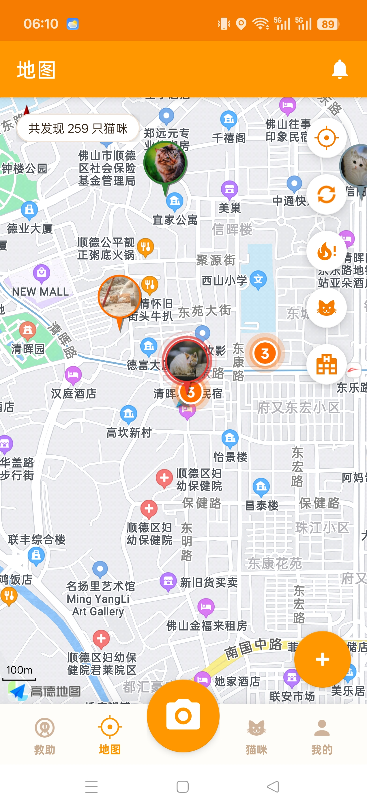
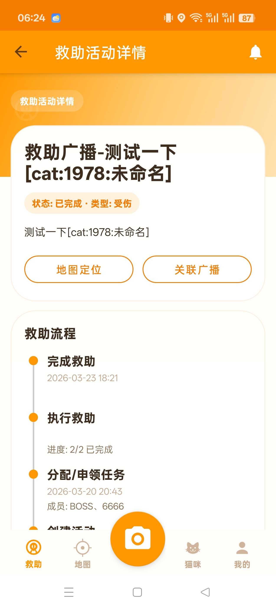
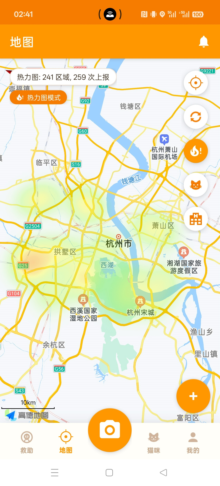
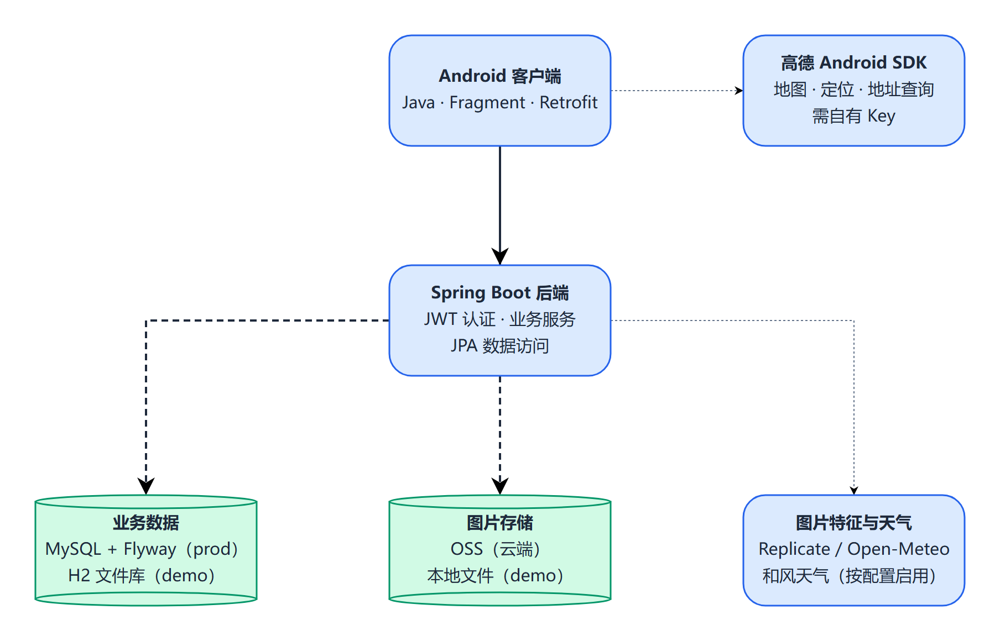
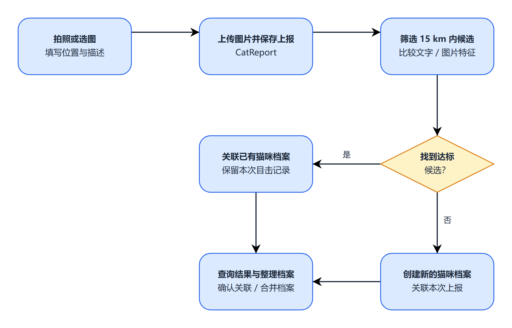
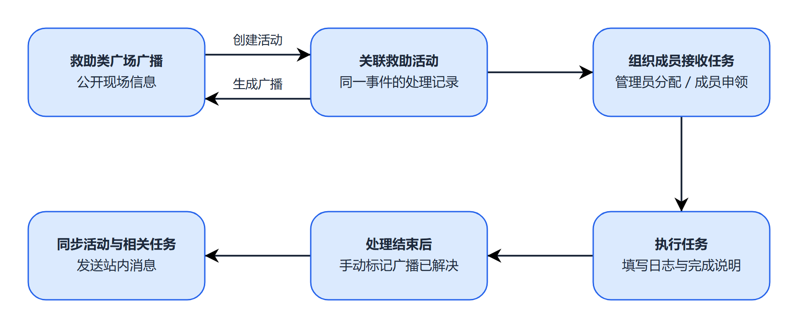

<p align="center"></p>

# OurCat Android · 校园猫谱客户端

OurCat 是采用 **Android + Spring Boot + MySQL** 实现的校园流浪猫综合救助平台。本仓库为 Java 编写的 Android 客户端，用于现场拍照上报、查看猫咪档案和位置、发布求助、参与救助任务及社区讨论。

同一只猫可以有多条目击记录，现场求助也可以继续进入任务分工和处理记录。客户端连接 [OurCat Backend](https://github.com/BlackCoder0/OurCat_backend)，公开体验包使用各自电脑上的后端和独立账号。

**[下载 Windows 后端与 APK](https://github.com/BlackCoder0/OurCat_backend/releases/tag/v0.1.0-local-preview.1)** · [第一次运行](https://github.com/BlackCoder0/OurCat_backend/blob/main/docs/local-experience.md) · [源码构建](#源码构建)

[界面展示](#界面展示) · [运行体验](#运行体验) · [主要功能](#主要功能) · [技术栈](#技术栈) · [架构与流程](#架构与流程) · [设计亮点](#设计亮点) · [源码构建](#源码构建)

## 界面展示

| 猫咪上报 | 地图点位 | 救助任务 |
| :---: | :---: | :---: |
|  |  |  |

| 热力分布 | 论坛交流 | 广场广播 |
| :---: | :---: | :---: |
|  |  |  |

[完整截图](docs/screenshots.md)包含上报表单、地图联动、推荐区域和救助进度。截图来自已配置地图等服务的版本；Demo 不提供真实地图，图片 AI 默认关闭。

## 运行体验

首次体验可下载 [Windows 后端与 APK 合集](https://github.com/BlackCoder0/OurCat_backend/releases/tag/v0.1.0-local-preview.1)，按[本地体验教程](https://github.com/BlackCoder0/OurCat_backend/blob/main/docs/local-experience.md)操作：

1. 在电脑解压 ZIP，双击 `start.cmd`，等窗口显示 `Started OurCatApplication`。
2. 安装包内 `OurCat-demo.apk`，手机与电脑接入同一 Wi-Fi。
3. 在登录页点“设置后端地址”，填电脑的局域网地址，例如 `http://192.168.1.20:8080/`；示例 IP 需要换成实际地址。
4. 看到验证码后注册账号，或使用电脑 `data/login-info.txt` 中的本机管理员账号登录。

应用名为“OurCat 本地体验”，包名为 `com.ourcat.app.demo`，可与原 App 共存。电脑必须保持后端运行。安卓模拟器连接宿主机时使用 `http://10.0.2.2:8080/`，手机不能用自己的 `localhost` 代替电脑地址。

## 主要功能

| 模块 | 客户端实现 | 运行条件 |
| --- | --- | --- |
| 猫咪上报 | 拍照或选图，填写位置、毛色、特征、性格与描述 | 后端；Demo 使用示例位置 |
| 猫咪档案与匹配 | 档案列表、搜索筛选、上报记录和匹配结果查看 | 图片匹配需后端配置；Demo 保留文字匹配 |
| 地图与区域查看 | 猫咪点位、热力图、活跃区域推荐、附近宠物医院、救助位置联动 | 普通构建需自有高德 Key，Demo 不提供 |
| 救助协作 | 发起活动、分配或申领任务、提交文字日志和完成说明 | 后端及对应组织、任务权限 |
| 论坛与广场 | 图文发布、评论互动、现场广播和救助关联 | 后端及图片存储 |
| 组织与账户 | 申请加入、审核、成员管理、资料和头像修改 | 后端及角色权限 |
| 消息与天气 | 查看系统通知、互动消息和天气预警记录 | 后端；天气服务需要网络与相应配置 |

救助日志页面目前支持文字记录，日志选图尚未实现。

## 技术栈

| 技术 | 用途与知识点 |
| --- | --- |
| Java / XML 布局 | Android 页面、表单和事件处理；源码兼容级别为 Java 11 |
| Activity / Fragment / Navigation 2.7.6 | 主界面容器、页面跳转、参数传递和返回栈 |
| ViewPager2 / RecyclerView / Material Components | 页面切换、列表复用、卡片、对话框与输入控件 |
| Retrofit 2.9 / OkHttp 4.12 / Gson 2.10.1 | 声明 HTTP 接口、异步回调、JSON 转换、请求头和超时处理 |
| Glide 4.16 | 图片加载、缓存和列表图片展示 |
| 高德地图 9.6 / 搜索 SDK 9.7 | 地图、点位、定位和地址查询；需要单独配置 Key |
| MPAndroidChart 3.1.0 | 统计图表展示 |
| SharedPreferences | 保存登录 Token 和 Demo 后端地址；使用应用私有存储，未额外加密 |
| JDK 17 / AGP 8.2 / Gradle Wrapper | 构建环境和不同构建类型的配置管理 |

最低支持 Android 7.0（API 24），编译和目标 SDK 为 34。依赖版本见 [app/build.gradle](app/build.gradle)。

## 架构与流程



实线表示客户端请求，虚线表示数据访问，点线表示按需启用的外部服务。可编辑图源位于[后端 diagrams 目录](https://github.com/BlackCoder0/OurCat_backend/tree/main/docs/diagrams)。

Activity / Fragment 负责界面和交互；`repositories` 目录中的 Retrofit API 接口声明请求；`RetrofitHelper` 统一建立连接和附带登录身份。图片由 `ImageUtils` 处理、`OssUploader` 上传，Glide 负责下载与显示。

### 猫咪上报



客户端选图后先申请上传地址，PUT 图片成功后，再将图片 URL、坐标和描述交给后端。后端保存上报，按地理范围和特征匹配已有档案；达标则关联，否则新建。页面再查询上报详情和匹配结果。

这条流程可从 `ReportCatDialogFragment → CatApi → Backend CatController → CatService` 阅读。后端先筛选 15 km 内的候选，再组合 Jaccard 文字相似度和可用的图片向量得分；具体规则见[后端匹配说明](https://github.com/BlackCoder0/OurCat_backend/blob/main/docs/architecture.md#匹配规则)。Demo 关闭图片 AI，客户端本身不携带识别模型。

### 地图怎样连接不同页面

普通 Debug / Release 由 `MainActivity` 保留 `MapFragment`，进入档案或救助详情时通过显示、隐藏地图容器切换界面。档案页、广场详情和救助详情可以把目标位置交回地图，减少重新进入地图时丢失现场上下文的情况。

`MapFragment` 同时提供猫咪点位、热力图、活跃区域推荐和附近宠物医院搜索。点位用于查看单次记录，热力图与推荐区域用于观察上报分布；医院搜索由高德 POI 服务提供。Demo 跳过这些真实地图功能。

### 救助与组织



救助类广播可以创建关联活动，从地图或档案发起活动也可以生成广场广播。组织申请由管理员审核；成员申领或接受分配的任务后，通过日志和完成说明留下处理记录。

相关入口包括 `OrgFragment`、`JoinRequestsFragment`、`RescueDetailFragment` 和 `SquareFragment`。广播标记为已解决后，由后端同步关联活动和任务的状态。

## 设计亮点

| 设计 | 作用 |
| --- | --- |
| 拍照入口串起上报与救助广播 | 从现场照片进入记录流程，继续补充猫咪信息或救助情况 |
| 常驻地图与位置跳转 | 由主界面管理地图实例，档案、广播和救助详情共用位置查看入口 |
| 地图信息分层 | 点位查看具体对象，热力图与推荐区域查看记录分布，附近医院搜索补充现场资源 |
| 论坛和广场分工 | 论坛保留经验讨论，广场承接现场广播；救助广播与活动双向关联 |
| 统一处理登录身份和图片上传 | 页面复用网络与上传工具，长期 OSS 凭据保留在后端 |
| 独立 Demo 构建 | 运行时填写后端地址，可与原包共存，便于在不同本地环境中学习和演示 |

## Demo 与普通构建

| 项目 | Demo | Debug / Release |
| --- | --- | --- |
| 后端地址 | 登录页填写，初始为 `http://10.0.2.2:8080/` | 从私有 `local.properties` 编译配置 |
| 包名 | `com.ourcat.app.demo` | `com.ourcat.app` |
| 地图与位置 | 不带地图 Key，上报和救助广播使用标明的上海示例位置 | 配置自己的 Key 后使用真实地图和定位 |
| 图片 | 配套本地后端保存到电脑目录 | 取决于所连后端，云端可使用 OSS |
| HTTP | 允许本地 HTTP | Debug 允许本地 HTTP；Release 默认禁止明文 HTTP |

Demo 不继承私人 Debug 地址或地图 Key。需要切换后端时先退出登录，再到登录页设置地址；保存新地址会取消旧请求、清除 Token 和最近浏览记录，并重新加载验证码。不同后端的账号不互通。

## 源码构建

需要 JDK 17 和 Android SDK 34。用 Android Studio 打开项目，确认项目根目录的 `local.properties` 中有正确 SDK 路径：

```properties
sdk.dir=C:/Users/用户名/AppData/Local/Android/Sdk
```

启动后端，再在 Android 项目根目录执行：

```powershell
.\gradlew.bat assembleDemo
```

输出为 `app/build/outputs/apk/demo/app-demo.apk`。macOS / Linux 使用 `./gradlew assembleDemo`。普通 Debug / Release 的后端地址、高德 Key 和签名配置见[开发指南](docs/development.md)。

```text
app/src/main/java/com/ourcat/app/
├── activities/     # 登录页与主界面容器
├── fragments/      # 上报、地图、档案、救助、社区和账户页面
├── adapters/       # 列表和图片选择适配器
├── repositories/   # Retrofit API 接口
└── utils/          # 网络、登录存储、图片处理与上传工具
app/src/main/res/   # 布局、导航、主题与图片资源
app/src/demo/      # Demo 构建配置
app/src/debug/     # Debug 本地调试配置
tools/             # 后端地址解析的独立检查
```

## 文档、验证与反馈

[开发与配置](docs/development.md) · [完整截图](docs/screenshots.md) · [验证记录](docs/validation.md) · [后端架构与接口](https://github.com/BlackCoder0/OurCat_backend)

已有验证包括 Demo / Debug 构建、Release 合并清单，以及 API 35 模拟器的地址保存、正常验证码登录、头像上传、带图发帖和猫咪上报。组织和任务权限另有后端接口测试；Android 角色页面的逐项手工验收尚未完成。

实体手机、其他系统版本、另一台干净 Windows 电脑和正式签名分发仍需检查。问题可提交到 [Issues](https://github.com/BlackCoder0/OurCat_Android/issues)，附 Android 版本、后端版本、构建类型和复现步骤，日志中遮掉 Token 和个人信息。

代码使用 [MIT](LICENSE)，第三方 SDK 遵循各自许可。
