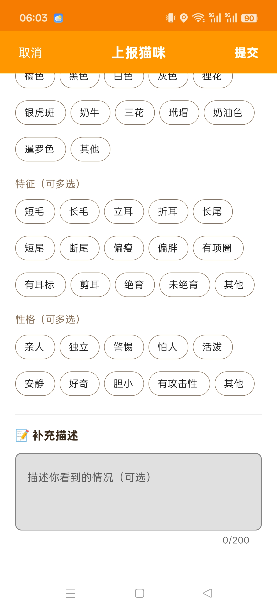
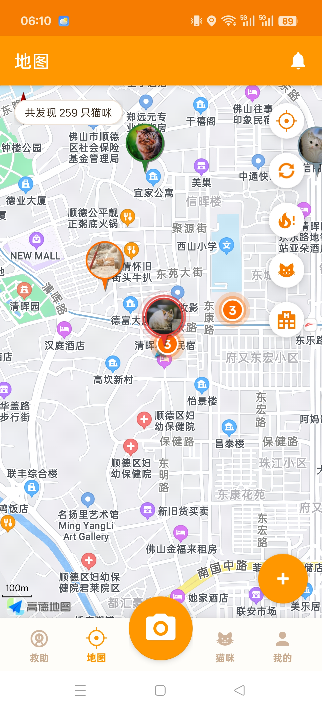
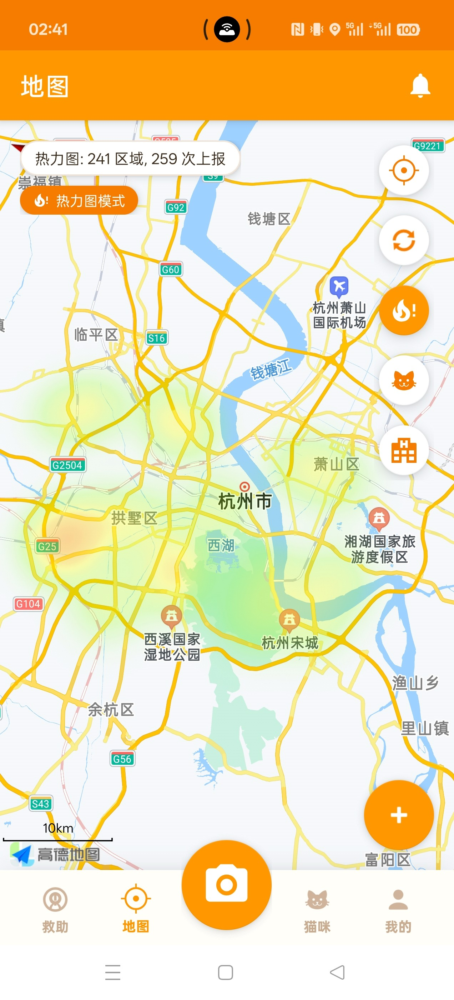

# 功能截图

> 以下截图按功能和使用顺序排列。

### 猫咪上报与匹配

| 上报表单（上半部分） | 上报表单（下半部分） |
| :---: | :---: |
|  |  |

### 地图与区域分析

| 猫咪点位地图 | 救助联动界面 | 热力图 |
| :---: | :---: | :---: |
|  |  |  |

### 论坛与广场

| 论坛帖子列表 | 广场广播发布表单（上半部分） | 广场广播发布表单（下半部分） |
| :---: | :---: | :---: |
|  |  |  |

| 论坛发帖编辑 | 
| :---: | 
|  |

### 地图推荐区域

| 地图推荐区域 |
| :---: |
|  |

### 救助活动

| 活动详情 | 进度追踪 |
| :---: | :---: |
|  |  |

---

这些截图来自配置过地图和云服务的项目版本；Demo 的地图入口和 AI 默认关闭。
